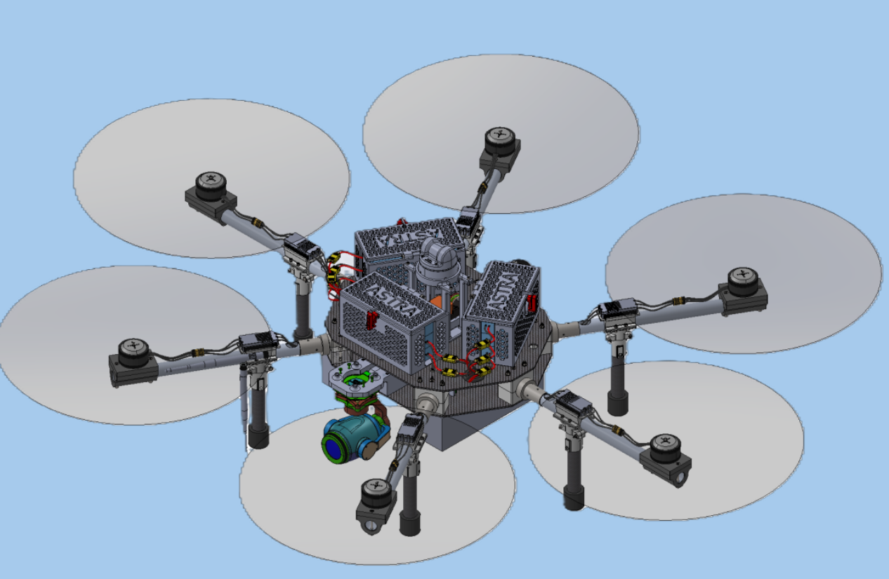
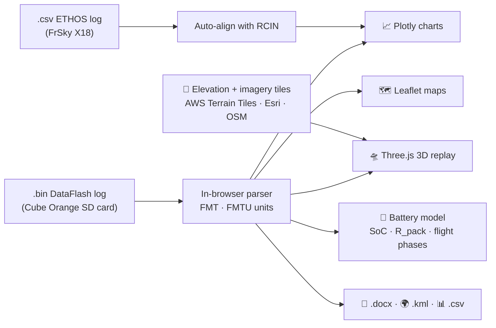

<!-- ─────────────────────────────────────────────────────────────────────────────
  EDIT ME: replace every "wsharrar" and "Sentinel-Log-Viewer" below with
  your GitHub username and repository name (search this file for "wsharrar").
───────────────────────────────────────────────────────────────────────────── -->

<div align="center">


# SENTINEL Log Viewer

### Flight-log analysis for **Sentinel**, the CPP SUAS ASTRA hexacopter

*Drop in an ArduPilot `.bin` log → replay the flight in 3D, check the power draw across the battery bank, and dig into every sensor. All in the browser.*

<!-- EDIT ME: live site link (badge) -->
[](https://wsharrar.github.io/Sentinel-Log-Viewer/)


<br>



<sub><b>Sentinel</b> &middot; Hexa X &middot; Cube Orange &middot; Jetson Orin Nano Super &middot; SIYI gimbal camera &middot; GPS + LiDAR</sub>

</div>

---

## 🌄 3D flight on real-world terrain

The flight replays over the **actual test site**: real elevation data draped with satellite imagery, with the drone flying its logged path in 3D.

| | |
|---|---|
| 🗺️ **Real terrain** | Elevation from AWS Terrain Tiles (USGS 3DEP / SRTM), draped with **Satellite**, **Topographic** or **Streets** maps, or switch to a plain grid |
| 🌈 **Flight line** | Thick 3D path coloured by height above home; the part already flown glows white during playback |
| 📏 **Altitude** | See-through *altitude curtain* from the path down to the ground, altitude sticks, a ground-track shadow, and a label at the highest point (above home and above the terrain) |
| 📍 **Waypoints** | Mission waypoints from the log as numbered pins with their altitude, poles to the ground and the dashed planned route |
| 🧭 **Orientation** | Home marker, north / east arrows, live telemetry, R/C sticks and spinning motor panel in sync |

> Terrain loads in the background. Until it arrives, or when you're offline, the replay runs on a grid.

## ✨ What it does

<table>
<tr>
<td width="50%" valign="top">

### 🛰️ Log Viewer
**3D flight replay on real terrain** with live motor outputs and R/C sticks, plus 20 analysis tabs:
attitude, altitude, GPS, IMU & vibration, accel & gyro, RSSI & radio, PID tuning,
EKF health, GPS heatmap, vibration FFT, geofence, satellite map, anomaly timeline,
diagnostics and an ArduPilot-style **Custom Plot** of any log field.

</td>
<td width="50%" valign="top">

### 🔋 Battery System
6S9P pack status, **voltage / current / power** plots, state of charge,
per-pack load across all nine parallel packs, and **current by flight phase**:
takeoff and landing peaks, steady-flight average and the extra current drawn while **yawing**.

</td>
</tr>
<tr>
<td valign="top">

### 🎮 Transmitter
FrSky Tandem X18 (ETHOS `.csv`) stick inputs, switches and RSSI, auto-aligned with
what the Cube Orange recorded in the `.bin`.

</td>
<td valign="top">

### ⚡ Electrical Schematic
Full wiring diagram of the airframe and the Cube Orange pin-to-pin connections.

</td>
</tr>
</table>

### 🧰 Built-in tools

| | |
|---|---|
| 📐 **Unit conversion** | Ruler button beside each chart's *Download PNG* button: m/s ⇄ mph / ft/s / km/h, m ⇄ ft, ° ⇄ rad, Lat/Lng ⇄ decimal ° / metres, and more |
| ✅ **Matches plot.ardupilot.org** | Values are parsed the same way as the official ArduPilot log viewer (checked field by field on a test log); field units come from the log's own FMTU table |
| ⏱️ **Shared time cursor** | Turn on **Time Cursor**, then click any chart to move a cursor across every chart, both maps and the 3D replay at once |
| 🚩 **Event markers** | **Show Events** overlays arming, mode changes, failsafes and errors on every plot |
| 📄 **Flight report** | One click builds an editable Word (`.docx`) flight report |
| 🌍 **Google Earth export** | KML of the 3D flight path (plus a by-flight-mode layer you can switch on), takeoff / landing and waypoints |
| 📊 **CSV export** | Every chart, or the whole log |

---

## 🚀 Quick start

**Online:** open the live site. Nothing to install.

<!-- EDIT ME: live site link (text) -->
> 👉 **https://wsharrar.github.io/Sentinel-Log-Viewer/**

**Offline:**

```bash
git clone https://github.com/wsharrar/Sentinel-Log-Viewer.git
cd Sentinel-Log-Viewer
# then just open index.html in Chrome / Edge / Firefox
```

1. Click **Load a flight log** (or drag a file onto the page).
2. Pick an ArduPilot DataFlash log (`.bin`) from the Cube Orange SD card.
3. Explore the tabs. Hover a chart for **📷 PNG** and **📐 Units**.

> [!NOTE]
> Logs are parsed **entirely in your browser** and are never uploaded. The 3D view and maps only download public map and elevation tiles for the flight area.

---

## 🛠️ How it works



| Built with | |
|---|---|
| [Plotly.js](https://plotly.com/javascript/) | Interactive charts |
| [Three.js](https://threejs.org/) | 3D flight replay and terrain mesh |
| [AWS Terrain Tiles](https://registry.opendata.aws/terrain-tiles/) | Open elevation data (Terrarium tiles) for the 3D terrain |
| [Esri World Imagery](https://www.arcgis.com/home/item.html?id=10df2279f9684e4a9f6a7f08febac2a9) · [OpenStreetMap](https://www.openstreetmap.org/copyright) | Satellite, topographic and street imagery |
| [Leaflet](https://leafletjs.com/) | Satellite and geofence maps |
| Plain HTML / CSS / JS | No build step, no framework, no server |

---

## 🔩 Sentinel at a glance

| | |
|---|---|
| **Airframe** | Hexa X, 6 motors |
| **Flight controller** | Cube Orange (ArduCopter) |
| **Companion computer** | NVIDIA Jetson Orin Nano Super |
| **Power** | Custom 6S9P bank: 9 × 6S1P Molicel P45B packs, 54 cells, 40.5 Ah / 874.8 Wh |
| **Camera** | SIYI gimbal |
| **Sensing** | GPS, LiDAR |
| **Radio** | FrSky Tandem X18 (ETHOS) |

---

## 📁 Repository layout

```
├── index.html          ← the whole app (served by GitHub Pages)
├── README.md
├── astra logo.png      ← logo / favicon
├── sentinel_real.png   ← Sentinel render
├── elec schematic.png  ← airframe wiring
├── cubeorange.png      ← Cube Orange pin-to-pin diagram
├── battery*.png        ← battery system art
└── .gitignore          ← keeps .bin / .csv flight logs out of the repo
```

> [!TIP]
> Flight logs (`*.bin`, `*.csv`) are git-ignored: real logs easily pass GitHub's 100 MB file limit. Keep them locally and load them in the viewer.

---

<div align="center">

**Cal Poly Pomona · Student Unmanned Aerial Systems · ASTRA**

<sub>Autonomous Science and Technology Robotic Aircraft</sub>

<!-- EDIT ME: repo link (footer) -->
[🌐 Live site](https://wsharrar.github.io/Sentinel-Log-Viewer/) &nbsp;·&nbsp; [📦 Repository](https://github.com/wsharrar/Sentinel-Log-Viewer)

</div>
